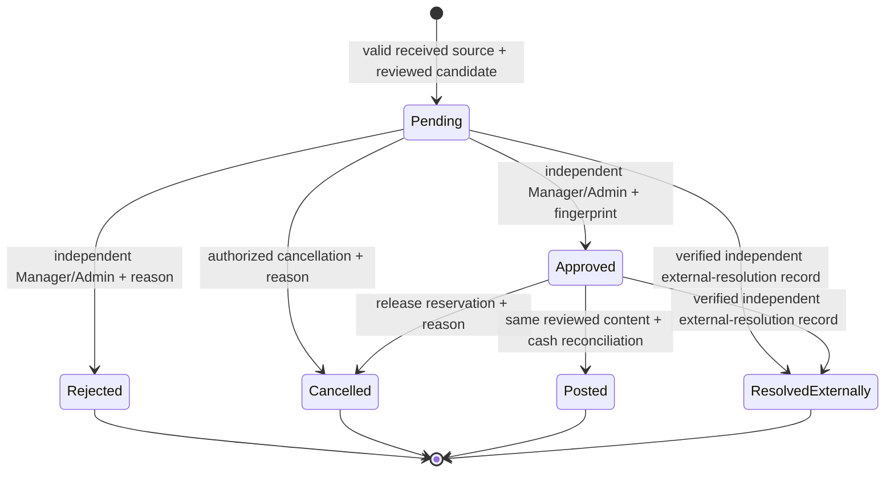

# Batch 12 — Product exchange technical specification

Date: **22 November 2026, Asia/Manila**. **PROPOSED DESIGN ONLY — NOT IMPLEMENTED, MIGRATED OR ACTIVATED.**

Authority and unresolved legal scope: [research L01–L09 and E01–E15](BATCH12_EXCHANGE_RESEARCH.md). Required decisions/tests: [validation checklist](BATCH12_EXCHANGE_VALIDATION_CHECKLIST.md). Names, tables, endpoints, state machines and algorithms below are proposals. Approval of this document would not itself authorize a production migration or feature activation.

## 1. Design goals and exclusions

Add a module inside the existing Express application and Returns/Approvals UI. Reuse authentication, CSRF, active-role checks, money parsing, Manila dates, FEFO, transaction/audit helpers, report filters and export safeguards. No second application, payment gateway, microservice, general accounting engine or transferable store-credit system is needed.

Preserve ordinary and locally tested benefit checkout unchanged. Do not call ordinary checkout to manufacture a sale/payment equal to replacement value. Preserve original sale/payment/financial snapshots and applied migration history. Product exchange does not imply automatic medicine restocking, cash refund, revenue reversal, clinical substitution or fiscal invoice issuance.

### Supported versus held scenarios

| Scenario | Proposed capability | Gate |
| --- | --- | --- |
| Voluntary equal-value exchange | Approved received return, independently reviewed replacement, zero extra cash | Owner valuation/window/condition policy and clinical suitability |
| Voluntary higher-value choice | Same flow plus actual positive cash difference | Explicit customer choice and approved price/settlement policy |
| Lower-value replacement | Quote shows unused amount; final posting unavailable until lawful settlement defined | Owner/legal/accountant decision; no automatic forfeiture, store credit or cash refund |
| Defective same-kind replacement | Separate remedy route; no automatic customer charge merely because retail price changed | Consumer remedy and fiscal/document policy; do not reuse voluntary arithmetic blindly |
| Different-kind statutory remedy, recall, dispensing error | Protected review/escalation; chosen remedy and responsible-party allocation retained | Qualified legal/pharmacist/accountant decision |
| Senior/PWD original or replacement | Separate historical entitlement and fresh replacement assessment | All applicable Batch 9 B01–B16 plus exchange-specific vectors; local test-only provider only until separately approved |
| Replacement itself defective | New linked replacement-return source, independent decision/receipt, then a new exchange | Same applicable remedy/clinical gates; no one-exchange-only restriction |
| Missing receipt, unlinked legacy record or other proof | Reviewed human case handling, no automatic posting | Establish source lawfully without inventing original sale/items or rejecting rights solely for missing paper |

These are proposed release boundaries, not new legal exclusions. A blocked software case needs an effective approved human remedy path and must remain visible as unresolved, not be falsely marked settled.

## 2. Three independent balances

1. **Physical return balance:** received units minus approved physical dispositions. Existing `quarantined_remaining` belongs here.
2. **Remedy claim balance:** approved/physically received units minus active approved reservations, posted exchange consumption and independently verified external-resolution consumption for that source return. Rejected/cancelled claims do not consume it; pending requests do not reserve it.
3. **Settlement balance:** historical return value applied, replacement consideration, actual additional cash and any unresolved difference under a reviewed policy.

Never derive balance 2 from balance 1. Goods may already be destroyed or supplier-returned while a customer's remedy remains due. Exchange posting leaves the quarantine balance unchanged. Separate physical action is required even when the financial exchange is complete. An existing restock action does not automatically settle a customer claim or authorize another issue.

For an original sold line, approved returns remain capped by sold quantity under 008. For each approved received return, active exchange claims remain capped by received quantity. For replacement items, the new return source has the same sold/issued-quantity cap. Financial entitlement cannot be reused across simultaneous claims, different return rows, cancellations or retries.

## 3. Proposed workflow and permissions

### Request, review and posting

Database values: `pending`, `approved`, `rejected`, `cancelled`, `posted`, `resolved_externally`. The last is a proposed record of a separately verified lawful remedy, not an exchange posting or automatic refund operation. No completed state can reopen to pending, be deleted, be retroactively rejected or have its financial content amended. A changed candidate is cancelled and recreated with a new UUID and `supersedes_exchange_id`; old history remains. A posted correction requires a separately authorized forward process, not editing stock/payment history.

- Initiator selects one root receipt, approved physically received return(s), quantities and clinically suitable replacement product(s). Root = original paid sale, even for later replacements.
- Server establishes the remedy route and availability; no browser-supplied prices, rates, refund amounts, actor or approval identity.
- Server produces a candidate quote and records exactly what the initiator explicitly reviewed. Pending request creation does not change stock, cash or claim reservations.
- A distinct active Manager/Admin recomputes the candidate, validates evidence and capacity, then approves/reserves the specified original units. Approval alone does not deduct replacement stock or receive cash. Rejection requires a nonblank reason and no posting.
- Proposed posting actor is the original initiator/cashier; reviewer must differ. Two distinct accounts suffice. Reassignment needs cancellation/new reviewed request rather than sharing sessions. This preserves no-self-approval without inventing a third mandatory reviewer.
- Cashier refreshes/reviews a short-lived quote bound to the approved business fingerprint, confirms any additional tender/change, then posts atomically. Any critical change requires fresh review and independent approval of a new candidate.
- Approved reservations do not expire silently: cancellation/release is explicit and audited. An optional timeout policy is UNSPECIFIED; no stock is reserved while waiting. UI must show outstanding reservations and an authorized cancel action to prevent indefinite hidden holds.
- No additional routine approval is added to regular cash or valid benefit sales. Existing PO/Stock-In self-approval rules are untouched.

### External remedy resolution — proposed reconciliation safeguard

A known-source claim may need a lawful remedy outside automatic exchange settlement. Allow a review-only pending case with source quantities/evidence but no replacement quote; it cannot use the normal approve/post endpoints until it has a valid candidate. A separately privileged, independent Manager/Admin may record `resolved_externally` only after verifying an approved secure case reference, actual remedy evidence, affected source units/value, responsible actor/date and accountant/pharmacist reconciliation where applicable. Apply the same source locks, capacity/range checks, operation UUID and append-only audit. Existing reservations are consumed, not released for another claim; units settled before a reservation existed acquire bounded intervals in that transaction.

This endpoint records evidence; it does not pay cash, deduct stock, generate a fiscal document or claim a refund engine exists. No fake replacement items or `exchange_settlements` row is created. Any externally issued goods/cash/tax correction must already have an independently approved, referenced reconciliation; an unsupported note cannot mark an unexplained movement settled. Report these resolutions separately from posted exchanges/top-up cash. Duplicate automatic/manual resolutions must conflict against the same consumed source units. This proposal and its operational privileges are BLOCKED pending X19 approval. An unknown/unestablished source remains a human case until its true source can be verified; no placeholder root sale is allowed.

### Role matrix — proposed

| Operation | Employee | Manager | Admin | Additional condition |
| --- | --- | --- | --- | --- |
| Lookup source/create exchange | Yes, scoped operational view | Yes | Yes | Active session, approved/received source; no beneficiary bulk search |
| Read exchange/history | Own initiated record | Authorized branch records | Authorized branch records | PII/cost projection remains restricted |
| Approve/reject exchange | No | Yes | Yes | Different from initiator; current role rechecked under lock |
| Post exchange / recover attempt | Own approved request | Own approved request | Own approved request | No-self-review, current session, matching digest; history access separately authorized |
| Cancel pending/approved | Own request, if not posting | Authorized request | Authorized request | Lock and audit; cannot cancel committed exchange |
| Record external resolution | No | Separately authorized | Separately authorized | Independent verifier, proven remedy and source/cash/stock reconciliation; proposed privilege disabled pending X19 |
| Record physical receipt | Own replacement-return request | Authorized return | Authorized return | Approved, full once-only quantity; existing original-return permission preserved |
| Authorize clinical replacement | No role-derived right | Only if qualification verified | Only if qualification verified | Current professional authorization and appropriate SOP; no Manager=pharmacist shortcut |
| Approve physical disposition | No | Yes | Yes | Independent decision and clinical/professional requirements where applicable |
| Full reports/XLSX/PDF | No | Existing permitted day/week views only | Yes | Existing export restriction remains Admin-only |

No production account/qualification onboarding is designed as an implicit side effect. Staff availability, alternative authorized reviewer and clinical coverage are UAT prerequisites.

## 4. Additive schema proposal — provisional 012

**Specification only; no SQL migration file is created.** Reserve the final migration number/name only after checking repository history at implementation time. Preserve all existing files, especially applied 001/002/004; do not rewrite 003/007/008/009/011 to disguise new semantics.

The minimum normalized complete design proposed here has **six exchange tables plus two replacement-return/disposition tables**. The latter avoid relaxing 003's original-sale FK or denying remedies for a defective replacement. No generic credit wallet, new customer master, duplicate product catalog or replacement `sales` row is required.

### Data types and common constraints

- New exchange identifiers/request keys use application-generated UUIDs; existing IDs remain integer FKs. No `MAX(id)+1`, migration reseeding or replacement of baseline IDs.
- Timestamps use `timestamptz`, with an explicit persisted Manila business date for financial/report grouping. Preserve original timestamp conventions rather than retroactively rewriting historical dates.
- Positive integer base-unit quantities only. No fractional units or unit conversion inferred from product names. Enforce documented maximum cart/quantity/amount bounds before SQL.
- Money is exact decimal cents. Use unconstrained `NUMERIC` plus explicit finite, nonnegative, maximum and `scale <= 2` checks (or an equivalent domain) so excess precision is **rejected**, not silently rounded by a `NUMERIC(p,2)` assignment. Match the existing operational maximum of 12 whole digits. JavaScript uses BigInt cents and decimal-string JSON.
- Every snapshot has a supported version, source/evidence version, server-generated digest and required component fields. Known zero differs from unknown. Unknown historical tax is explicitly marked unknown, never filled from current metadata. Required replacement tax evidence cannot use unknown as a posting bypass.
- RESTRICT deletion of referenced history; no cascading deletion of sales, returns, users, source items, snapshots or posted exchanges. No new production permissions or credentials.

### Proposed tables

| Table | Required columns / relationships | Required invariants |
| --- | --- | --- |
| `product_exchanges` | `exchange_id`, unique `request_id`, `request_digest`, `root_sale_id -> sales`, `initiated_by -> users`, `state`, `revision`, `reason`, `remedy_route`, `customer_choice_ref`, `policy_version`, immutable policy/evidence snapshot and digest; reviewed/approved fingerprint, `reviewed_by`, `reviewed_at`; `posted_by`, `posted_at`, unique nullable `posting_request_id`, `posting_digest`; cancellation/rejection metadata; protected external-resolution reference/digest, verifier/actor/time/value and unique operation key; `supersedes_exchange_id`; financial/snapshot version, business date and confirmation reference | One root paid transaction; explicit legal/voluntary route; approved reviewer != initiator; posted actor = initiator under proposed flow; external resolution independently verified and source consumption reconciled; mandatory state-specific fields; no completed financial mutation; UUID/digest collision mismatch rejected |
| `exchange_claims` | `claim_id`, `exchange_id`, source discriminator; either `return_id -> sale_returns` with original `(sale_id,sale_item_id)`, or `replacement_return_id -> exchange_replacement_returns` with source `exchange_item_id`; root link; bounded original-unit interval `[unit_start,unit_end)`, derived quantity; original financial/version snapshot, applied-value and component allocation, rounding/allocation version | Exactly one source type; composite source links/root must agree; approved/received source; no overlapping active unit intervals for the same outbound source; per-return received cap and per-source issued cap; no blanket UNIQUE(return_id) that prevents legitimate partial exchanges |
| `exchange_pricing_lines` | `pricing_line_id`, `exchange_id`, stable logical `line_key`, `product_id -> products`, requested quantity; immutable product/name/form evidence, unit price, benefit scheme, price/tax basis, eligibility/tax evidence versions, policy/verification references; gross, VAT removed, discount, taxable/exempt/non-VAT bases, VAT and payable; clinical evidence reference; cost basis/coverage if known | Unique `(exchange_id,line_key)`; complete verified replacement classification where required; calculate once per logical product/price/tax group; totals and scheme match supported policy; no PII copied into ordinary projections |
| `exchange_items` | `exchange_item_id`, `exchange_id`, `pricing_line_id`, `product_id`, `batch_id -> batches`, allocated quantity, batch number/expiry and product snapshots; exact allocated financial components; historical cost if verified or explicit unavailable status | Composite line/header/product FKs; product matches batch; unique logical-line/batch allocation; positive quantities; allocated quantity/components sum to logical lines; stock deduction only during once-only posting; source remains immutable for later replacement returns |
| `exchange_settlements` | `settlement_id`, unique `exchange_id`, `mode` (`no_additional_cash` / `cash_topup`), applied return value, replacement payable, additional cash due, tender, change; policy and posted digest, posting actor/time, approved fiscal-document references/status, optional protected external-remedy reference | Exactly one settlement for each posted exchange, none presented as cash-collected before posting; cash equation and exchange equation; zero-extra mode has zero due/tender/change; no negative refund field, unused-credit forfeiture or fictional original-sale payment |
| `exchange_events` | `event_id`, `exchange_id` or replacement-return/disposition reference, event kind, actor FK, role snapshot, timestamp, revision, request/digest reference, bounded reason/evidence refs; unique `(entity,event_kind,operation_request_id)` | Append-only history; no full customer IDs/prescriptions/tokens in event text; valid state ordering; critical event also linked to existing `activity_logs` atomically; no duplicate posted event |
| `exchange_replacement_returns` | `replacement_return_id`, unique `request_id`/digest, `root_sale_id`, source posted `exchange_item_id`, quantity, reason/type, initiator, `pending/approved/rejected` decision fields, reviewer, physical receipt quantity/actor/time | Immutable source; posted outbound item only; cumulative approved quantity <= issued quantity; reviewer != initiator; physical receipt full and once-only after approval; no stock/payment change; no cycles or fabricated `sale_item_id` |
| `exchange_replacement_dispositions` | `disposition_id`, unique request/digest, replacement-return FK, quantity, `destroy/supplier_return` proposed action, reason, initiator, pending/approved/rejected decision, independent reviewer, execution/evidence reference | Approved fully received parent; cumulative approved disposition <= received quantity; no sellable stock increase; no duplicate action. New chain-return restocking remains unavailable without separately approved SOP and compatible ledger/constraints; do not bypass 008's original-return restock safeguards |

An original return's physical actions continue through existing `return_dispositions`; new chain-return actions use the additive table. The shared UI/service adapter must distinguish source types. The added chain table is not a second customer master or a new ordinary sale.

Composite unique keys may be added to existing parent tables solely to support reliable FKs, e.g. the return's actual root/sale-item tuple. Do not change 003's mandatory linkage or 008's definitions. Where product/batch consistency cannot use a new parent key, an explicitly reviewed constraint trigger must validate it under parent locks. Any such index/constraint must be reviewed against existing data first.

### State and aggregate enforcement

Define named canonical functions/triggers for lifecycle, source validation, claim caps/range overlap, pricing/allocation sums, settlement reconciliation, once-only posting and immutability. Check exact definitions/enabled triggers in runtime readiness, not only table existence. Service validation is mandatory; cross-row constraints need database enforcement as defense against competing writers.

Approval/post/cancel triggers lock the same source outbound line and parent return before testing active claims. Cross-row checks cannot be a row-local CHECK or unlocked SUM. Include all rows inserted/changed in the current transaction. Prevent direct child append/delete/reparenting after approval/posting. Immutable approved content can be changed only by cancelling and creating a new candidate. Reject edits/deletes to events and posted children, and deletion of audit/settlement evidence supporting a posted exchange.

The capacity predicate must explicitly include approved reservations and both terminal consumption states (`posted`, `resolved_externally`); terminal external resolution cannot be cancelled to free its units. Review-only pending cases reserve nothing. State-specific deferred checks require real replacement/settlement/audit evidence for `posted`, but independently verified external evidence and source-consumption audit for `resolved_externally`, with no artificial replacement/settlement rows.

Use deferred reconciliation where header/items/settlement/audit are inserted in one transaction. At commit verify: all posted source quantities are valid, reservations are converted once, each replacement allocation exists, one valid settlement exists, line/header sums agree and one linked posted audit event exists. Permission checks still rely on authenticated application context/current users; these constraints are not a claim of tamper-proof history against a database owner.

## 5. Financial snapshots and settlement mathematics

Let `C` be the approved applied historical return value; `P` the replacement payable after independently valid benefit/tax treatment; `A` additional cash due; `T` tender; `H` change. For the proposed voluntary equal/higher-value route only:

`P = C + A`, `A >= 0`, `T - H = A`, `T >= A`, `H >= 0`.

If `P < C`, show residual `C-P`, block posting under this route and escalate. Do not reduce C silently or hide the residual to make the equation pass. A lawful future lower-value policy needs explicit settlement/liability/document records and its own reviewed reconciliation; it is not an omitted negative-cash branch. Cash change is only change from additional cash tender, not a disguised refund of original consideration.

For each replacement logical/batch line:

`gross = VAT_removed + discount + payable`

`payable = taxable_base + exempt_base + non_VAT_base + VAT_charged`

Header components equal logical-line sums; batch allocations equal each logical line. VAT removed is not a second discount. Zero-rated, exempt and non-VAT are not interchangeable. Snapshot intrinsic classification separately from final transaction treatment. No client prices/totals, negative replacement quantities, arbitrary discount rate or invented accounting contribution is accepted.

### Original value and partial-unit rounding — proposed algorithm

For a supported legacy regular source, historical net consideration is original quantity × stored unit price, subject to existing paid-sale reconciliation. For financial v2, use persisted `net_line_amount` and actual allocated VAT/discount components. Never recompute the original benefit using today's rules. Unsupported v1/ambiguous historical states require explicit compatibility review, not an invented net value. Historical unrecorded tax stays unknown and cannot drive an automatic tax credit.

Legacy regular-sale product descriptions may be current lookup values because sold-time names were not captured. Label their provenance honestly. A new exchange can freeze the lookup label at exchange time, but cannot claim to reconstruct an unrecorded historical name/form/strength.

Allocate disjoint ordinal intervals within each actual outbound batch line, not a new monetary balance based on the current product price. Proposed deterministic **prefix allocation v1**:

1. For original line quantity Q, gross G, removed VAT V, discount D and net N, define `G(q)=HU(G*q/Q)` and `N(q)=HU(N*q/Q)` for integer prefix q in [0,Q], all amounts in cents. `HU(n/d)=floor((2*n+d)/(2*d))` is proposed nonnegative half-up rounding. Require G = Q × stored cent unit price for this supported adapter.
2. Let `R(q)=G(q)-N(q)`. If G-N>0, define `V(q)=floor(R(q)*V/(G-N))` and `D(q)=R(q)-V(q)`; otherwise require V=D=0 and use zero for both. Gross per base unit is constant, so these prefixes and their net/component differences remain nonnegative. This preserves proportional historical net consideration first, while reconciling the original VAT-removal/discount split.
3. Allocate known charged-VAT/tax-base components within the monotonically increasing N(q) using the same bounded nested-prefix rule and a documented component order; derive the final residual component. Unknown legacy components remain unknown.
4. For interval [a,b), claim each component as its prefix at b minus prefix at a. Q's full prefix must equal the original stored components exactly; each component remains nonnegative. Store interval, allocation version and original snapshot digest.
5. Select unused intervals under the source-item lock. Cancelled reservations release their exact intervals; new claims can reuse those holes. **Do not use SUM(active quantities) as an offset**: cancellation would cause overlapping cents/units. One return may require several interval rows. No one-row-per-tablet expansion is needed.

The same physical-batch source can have several approved return records; intervals must be disjoint across all active claims for that source while each return separately respects its received cap. Quantity ordinals are an accounting allocation for fungible supported units, not invented serialized tablet identifiers. Legal/accountant approval of valuation and rounding is required. Separate property tests must prove monotonicity, component identities, cancellation-hole reuse and full-source cent conservation.

For statutory same-kind replacement, this proposed historical monetary basis is informational until the remedy policy is approved: a later retail price rise must not automatically create customer top-up. Do not fabricate a discount, supplier contribution or zero-priced sale to force voluntary equations onto that case.

### Senior/PWD exchanges and prescription evidence

- Preserve the original beneficiary/scheme/document linkage through protected server references. Same-person/exclusive-use and any representative verification follow applicable scheme SOP; no blanket OSCA-only ID or Senior booklet requirement. PWD rules remain distinct.
- Revalidate replacement eligibility, tax basis, price provenance, documentary state, effective policy and clinical suitability. Explicitly ineligible items differ from unknown items; no coercion of unknown to Regular/ineligible.
- Reuse the verified calculation engine per logical replacement line, then allocate to FEFO batches. For an already exempt or non-VAT price do not remove VAT again. Apply exactly one approved scheme, no second 20% to a net original credit or only the top-up.
- Treat `C` as historical settlement value, not a fresh statutory discount or automatically transferable benefit entitlement. Mixed eligible/ineligible replacement baskets need independently classified lines and exact sums.
- The existing `benefit_prescription_fills` contract is sale-specific. Do not create a fake sale FK, decrement it silently or infer unused prescription balance because stock was returned. Propose an additional exchange-linked dispensing-evidence reference in the protected pricing-line snapshot plus an approved append-only prescription correction/fulfillment adapter. Its exact legal accounting of defect replacement versus additional dispensing is **BLOCKED** pending pharmacist SOP and isolated tests; a new relational fill ledger may be required after that contract is approved.
- Default no discounted exchange posting until these inputs are approved; preserve regular checkout and original discounted receipt recovery. Synthetic configurations prove arithmetic, not real policy validity.

## 6. Transaction, locking, rollback and recovery contract

Use one explicit pool/client per operation and transaction-safe internal helpers. Do not nest public workflow services that obtain their own clients. Preserve the account/POS advisory-lock convention; avoid lock upgrades.

### Required lock order

1. BEGIN; take existing **exclusive** advisory transaction lock `(742901,2)` for new exchange mutation/decision/posting, consistent with account/POS serialization. Existing prepared workflows use shared access; never acquire shared then upgrade. This conservative design trades throughput for compatibility until measured/reviewed.
2. Recheck active initiator/reviewer/current actor as appropriate. Acquire exchange request/posting UUID advisory lock using a separately reviewed namespace, with a uniqueness constraint as the authoritative duplicate defense; advisory hash collisions only serialize unrelated requests.
3. Lock root sale/source outbound items in deterministic source-kind/ID order; then referenced original or replacement return parents, then exchange headers/claim rows. All new chain-return/disposition operations must follow source-item-before-parent order. Audit lock behavior of existing 008 triggers before implementation; no reverse batch->return dependency may be introduced.
4. Lock effective clinical/benefit/policy/verification records and relevant professional authorization rows in deterministic ID order. Check validity/revocation/current date again; role changes remain serialized by the global lock. Do not assume a shared lock alone prevents clock expiry.
5. Lock replacement products sorted by product ID, then FEFO batches by product, expiry, batch ID. Use the same order as POS. Only positively stocked batches with expiry **after** the current Manila business date qualify; unknown dates unavailable.
6. Recompute critical fingerprint and capacity, apply all writes, run deferred reconciliation, COMMIT. No network research/external API wait while locks are held. Release client in finally; rollback every error.

Implementation must test interactions with ordinary POS, return approval, original dispositions/restock, price editing and account/qualification revocation. A deadlock/serialization retry is bounded and uses the same durable operation key. Never retry an uncertain COMMIT by starting an unrelated transaction identity.

### Atomic posting sequence

1. Resolve an already committed matching posting UUID/digest **before** live price/evidence/gate revalidation; return its persisted confirmation only to an authorized actor. A changed request/actor cannot replay it.
2. For new work, check feature/schema gates and current independent approval. Reconcile the root sale/payment/items/cashier audit with existing helpers; verify original source snapshots/digests and approved full physical receipt.
3. Confirm reserved intervals/quantities belong to this exact approved candidate and remain within received/issued caps. Approved intervals were reserved under parent locks; posting converts them to permanently consumed, without changing their amounts.
4. Revalidate signed quote, business date, price/benefit/tax/document/clinical evidence, product and FEFO allocations. Reject stale candidates before cash/stock changes. Require renewed review; if critical fingerprint changes, cancel/recreate/reapprove.
5. Deduct each replacement batch with guarded `qty_on_hand >= allocation` and expiry predicate; require all allocations to update. Insert immutable logical/batch snapshots and valid settlement (or finalize their approved immutable candidate rows as posted).
6. Append linked exchange-posted event and existing audit action by opaque exchange reference. If prescribed, append protected dispensing evidence under its separately approved adapter. No existing `payments` row, `sale_returns` quantity, disposition or original sale is financially rewritten.
7. Verify aggregate/header/payment/claim/audit invariants and commit. Any failure, including audit insertion or deferred constraint failure, rolls back **all** stock, claims, settlement and snapshots. Cash handover/release of replacement goods follows confirmed posting under staff SOP; software cannot roll back physical cash after handing it over.

### Quote review and ambiguous acknowledgement

Signed mode `exchange`, supported version, actor, exchange/revision, fingerprint and expiry (proposed five minutes). Fingerprint includes all source claim intervals/values, route/policy, replacement quantities/prices/tax/benefit/clinical versions, FEFO allocation/expiry, business date, approved reviewer identity and settlement due. Token expiry/refresh timestamps are not themselves business changes. Tender is bound to the final posting digest, while approval authorizes the exact due; changing tender requires cashier review but not a new commercial approval if due/content is identical.

Refreshing an expired token with an identical critical fingerprint may retain the approval after current authorization checks. Any different business fingerprint, even with the same total, requires a new candidate/review. No silent FEFO substitution after approval.

Separate `request_id` and `posting_request_id`/digests. Resolve responses: `posted` with persisted confirmation; `not_posted` only when serialized against the in-flight attempt and durably closed; `pending/approved` as workflow state without asserting an uncertain attempt failed. Use an append-only closure event for an unused posting key. A closed key can never later post.

After timeout/network failure, lock the UI and keep only opaque recovery metadata. Resolve the existing attempt; do not offer a new UUID based on an error toast or a 404 race. Matching committed replay must survive catalog rename, revoked policy, expired quote, restart and new-work gate-off. Current authentication/authorized scope still applies. Login/session expiry does not permit another actor to take over an unresolved attempt.

## 7. Proposed API surface — not exposed by this batch

| Endpoint | Purpose / constraints |
| --- | --- |
| `GET /api/exchanges/availability` | Authenticated safe availability, supported source/scheme/settlement modes and nonsecret blocker codes; flags alone insufficient |
| `GET /api/exchanges/sources?receipt_no=...` | Exact bounded operational lookup, rate-limited/no-store; reuse original receipt reconciliation and scope. Redact application/access logs; no beneficiary IDs in query/search |
| `POST /api/exchanges/quote` | Source return IDs/quantities, replacement product IDs/quantities, route and opaque evidence refs only; server owns financial values; returns itemized candidate/fingerprint/token |
| `POST /api/exchanges` | UUID, reviewed quote token and accepted candidate references; create pending once; changed UUID payload => conflict |
| `GET /api/exchanges` / `GET /api/exchanges/:id` | Own operational or management authorized list/detail/history; server pagination/date/state filters, no client-side RBAC assumption |
| `POST /api/exchanges/:id/decision` | `approve/reject`, revision/fingerprint, nonblank reason and UUID; Manager/Admin independent review; reserve only on approval |
| `POST /api/exchanges/:id/cancel` | Explicit reason/revision/UUID; release approved reservations atomically; no cancellation of posted exchange |
| `POST /api/exchanges/:id/external-resolution` | Separately authorized, independently verified evidence-only closure; consumes exact source units once, no automatic cash/stock/tax action; unavailable pending X19 |
| `POST /api/exchanges/:id/quote` | Cashier fresh quote for approved content; distinguish unchanged token renewal from stale business fingerprint |
| `POST /api/exchanges/:id/post` | Posting UUID, exact reviewed token, tender string; strict schema rejects supplied price/rate/actor/refund fields |
| `GET /api/exchanges/:id/attempts/:request_id` | Authorized attempt status; not-found is not permission to duplicate an uncertain request |
| `POST /api/exchanges/:id/attempts/:request_id/resolve` | Serialized completion lookup or durable closure; CSRF-protected even though recovery may close rather than post |
| `GET /api/exchanges/:id/confirmation` | Historical persisted internal transaction confirmation, protected projection; never infer fiscal registration |
| `POST /api/exchanges/replacement-returns` | New claim against a posted replacement item; request/decision/receipt/disposition suboperations mirror protected original-return semantics with explicit source type |
| `GET /api/reports/exchanges` and approved export variants | Admin full report/exports; existing Manager time-limited report permissions preserved; exact shared-filter totals |

The replacement-return suboperations must include independent `/decision`, once-only `/receive`, `/dispositions` request and `/dispositions/:id/decision`, with own/management scopes and UUIDs. They cannot reuse an original-return ID in 008. Extend consolidated approvals with actionable exchange and replacement-return/disposition types; keep completed history accessible. No regular sale/valid benefit checkout is added to the queue.

Error contract: 400 strict shape/quantity/money; 401 session; 403 role/no-self/professional authorization; scoped 404 for inaccessible references; 409 stale candidate, state/capacity/idempotency conflict; 422 incomplete documentary/clinical requirements; 503 unavailable schema/policy/unsupported settlement route. Do not disclose credentials, full IDs, SQL or internal database details. A legal-remedy case needing review is displayed as review-required, not “customer has no right to exchange.”

## 8. Replacement-return chains and medicine handling

Original `sale_returns` stays linked to original `sale_items`. A replacement return references the **immediate posted outbound `exchange_item_id`**, plus the immutable root sale. That item identifies the actual issued batch/quantity/financial snapshot; do not point a later return at a different original batch merely to satisfy an FK.

Require independent Manager/Admin decision and actual full physical receipt before another exchange claim. Cap approved replacement returns by that immediate item's issued quantity, and exchange claims by the new received quantity. Reject self-reference, ancestor cycles, source not posted, cross-root links and duplicate units. Future replacements form a lineage through immutable posted items; returning the same units twice is prohibited, not a second legitimate defect remedy.

A subsequent monetary allowance is policy-specific. Do not mint transferable credit or treat a warranty replacement's catalog value as new customer-paid cash. Preserve funding provenance (original consideration applied, actual top-up, any legally approved noncash remedy component) in the source snapshot and enforce source caps. If a warranty/benefit chain lacks an approved valuation rule, record/escalate the claim without automated settlement. Never let repeated exchanges increase available paid consideration through arbitrary repricing.

Returned medicines stay in appropriate quarantine until an authorized decision. No automatic sellable increase occurs for original or replacement-return paths. New replacement-return dispositions initially support only controlled destroy/supplier-return records under the proposed scope. Any future restock option needs verified lawful patient-return SOP, pharmacist qualification/assessment, suitable quality/custody/expiry and additive stock-posting constraints. Existing original-return restock code is preserved, not extended by bypassing its guard triggers.

Recall, counterfeit/quality complaints and dispensing error may need manufacturer/FDA reporting, investigation and evidence retention. These duties cannot be replaced by a successful exchange. Use secure case references and pharmacist SOP; do not invent external integration or claim general adverse-event reporting is implemented.

## 9. Reporting, exports and historical confirmations

| Measure | Definition / effect |
| --- | --- |
| Original paid sales / original cash | Existing reconciled `sales` + `payments` cohort unchanged, including supported benefit snapshots. Pending/rejected/approved/posted exchanges never erase it. |
| Posted exchange count | Distinct reconciled posted exchange IDs in selected Manila posting period; not ordinary POS transaction count |
| External remedy resolutions | Separately verified source consumption/case status, excluded from posted replacement/top-up measures; referenced cash/stock/tax adjustments are not inferred or counted twice |
| Replacement units/value | Sum actual posted replacement items / logical payable; value is consideration, not extra cash. Avoid multiplying rows through claims, items and events joins. |
| Return value applied | Sum approved consumed historical value under the specified route/policy; noncash settlement measure, not automatic fiscal credit or tax deduction |
| Additional cash collected | Sum reconciled settlement `additional_cash_due`, equal to tender minus change; zero-extra exchanges contribute zero |
| Combined gross cash history | Original reconciled cash receipts + actual posted exchange top-ups, shown with explicit period/source categories; not labeled accounting net revenue |
| Product movement | Keep ordinary paid units and replacement outbound units separate; optional combined outbound units explicitly labeled. Physical returned/disposed units are separate again. |
| Discounts / tax | Original snapshots unchanged; replacement snapshots distinct. Do not double-count original statutory discount as a new concession or tax deduction. Fiscal adjustments require approved documents. |
| Stock / valuation | Actual replacement FEFO deductions affect stock; return acceptance/financial claim does not add stock. Quarantine and dispositions remain separate quantities. |
| Margins / COGS | Withhold unsupported exchange margin/net-profit figures. Catalog price minus current batch cost or top-up minus replacement cost alone is not an approved exchange accounting model. Show verified cost/coverage separately only if appropriate. |

Add a dedicated exchange report/detail rather than silently changing the ordinary sales definition. Return request state summaries remain independent. Any future accountant-approved revenue/discount/VAT adjustments must be append-only, document-linked and separately reconciled; they do not rewrite original cash history. Support source-sale date and exchange-posting date separately; no retroactive current-period adjustments by assumption.

Reuse `report-exports.js` with shared server-side filtered datasets, decimal strings, formula escaping, existing row limits, no-store responses and Admin permission. Screen, XLSX and parsed PDF totals must agree. Ordinary exports contain opaque transaction references and financial/movement fields only; no beneficiary name/ID, representative details, prescription identifiers or clinical notes. Authorized statutory evidence access requires a separate reviewed privilege and audit.

Internal exchange confirmation: stable opaque reference, original receipt and immediate source references, return quantities/batches, issued product/batch/expiry snapshots, gross/discount/VAT components, applied return value, replacement payable, actual cash/tender/change, actor/reviewer and Manila time. Reopening history uses persisted values and the same reference. Label **“Exchange transaction confirmation — not a registered fiscal invoice.”** Fiscal documents, numbering and credit-note/replacement invoice pairs remain blocked until approved branch evidence/template exists.

## 10. Desktop UI and wireframe alignment

Reuse the existing shell, red primary actions, white bordered cards, restrained status colors, compact tables and role navigation. References are visual guidance, not authority for sample identities, prices, 90-day alerts, cashless methods or routine discount approvals.

| Reference | Proposed application |
| --- | --- |
| `Access.png` | Current account-derived role, authentication/session recovery; no UI role selector grants permissions |
| `OVERVIEW.png` / `cards.png` | Keep existing sales/alerts cards accurate; an exchange badge can show unresolved actionable work only if approved; no fake revenue increase |
| `OPERATIONS.png` | Returns receipt search remains entry point. Add Returns / Exchanges tabs or a detail section; original receipt/items and approved/received status precede “Prepare exchange” |
| `INVENTORY.png` | Reuse searchable product/batch table and eligibility badges. Select product/quantity; server allocates FEFO, not a cashier batch override |
| `MANAGEMENT.png` | Add Exchange / Replacement Return filters to Unified Approvals; show requested-by, original value, replacement value, additional cash, route and state distinctly |
| `ADMINISTRATION.png` | Preserve Admin boundaries/audit history; no self-assigned pharmacist status, arbitrary statutory rule editor or invented new notification delivery |
| `Dialogs.png` | Reuse accessible review/reject/detail modal treatment and historical confirmation. Do not copy the reference's implicit fiscal/print authority |
| `TGP Clickable Wireframe.png` | Preserve menu grouping and consistent spacing across all proposed screens; no unrelated new application/navigation hierarchy |

### Proposed user journey

1. **Find source.** Exact receipt or exchange confirmation reference. Show legitimate source items, sold batch, supported historical price/benefit, approved returned/received quantity, reserved/exchanged quantity and remaining claim quantity. Distinguish “no matching transaction” from a rights-based refusal; provide human-review guidance for other evidence.
2. **Choose returned units and reason.** Multiple lines under one root receipt; positive supported base units; no writable value field. Unreceived/pending/rejected source has a clear prerequisite message. Show quarantine/disposition independently.
3. **Select replacement.** Reuse medicine/generic search, quantity controls, available eligible FEFO stock, expiry and clinical requirements. Show unknown evidence as unavailable, no estimated discount presented as final. Clinical equivalence is not auto-suggested from price.
4. **Review candidate.** Two-column original/returned and replacement cards. Right-side settlement panel: applied return value, replacement gross, VAT removal, benefit discount, tax bases/VAT, replacement payable, additional cash, or unresolved lower-value difference. Show policy/route/evidence status without exposing unnecessary beneficiary data.
5. **Submit and independent review.** Explicit “Submit exchange for review”; managerial dialog states approval reserves the claim but does not post stock/cash. Reject requires reason. No approve button for own request; server denial also required.
6. **Complete approved exchange.** Cashier reviews fresh identical approved candidate, enters extra cash only when due, sees change, then “Complete exchange.” Changed candidate explains why re-review is needed. Lower-price/unverified statutory cases show controlled review-required state; no misleading success button.
7. **Unknown result.** Disable new attempts, display “Checking exchange outcome,” preserve opaque key, resolve/recover persisted confirmation. Session expiry prompts reauthentication; it does not reset the unresolved transaction.
8. **History.** Timeline separates return approval, physical receipt/quarantine, exchange review/posting and physical disposition. Original and replacement confirmations are linked. “Return a replacement” starts a new source-specific claim, never reuses consumed units.

Target 1366×768 and 1440×900 desktop layouts with keyboard focus/labels, accessible modal focus trapping, explicit decimal/currency labels, readable disabled explanations, pagination and Manila dates. Keep the cart and settlement visible without a lengthy identity form forcing core actions far below the fold. Sensitive fields remain protected server-backed references; no IDs in localStorage, query strings, generic error/audit logs or recovery JSON.

## 11. Migration dependencies, compatibility and rollback

| Existing proposal | Status from inspected baseline | Exchange dependency / caution |
| --- | --- | --- |
| 001 / 002 / 004 | Original applied history preserved | Keep exact checksums and legacy data behavior; no file rewrite |
| 003 | Proposed linked-return migration, tested locally historically | Requires empty `sale_returns` under its current guard. Populated production returns need a separately reviewed backfill/remediation plan; never bypass or fabricate linkage |
| 007 | Protected decisions, local-tested proposal | Required current lifecycle/role/once-only semantics |
| 008 | Quarantine/disposition/qualification, local-tested proposal | Required physical receipt and original-return invariants; do not alter canonical functions casually because runtime readiness compares definitions |
| 009 | Original financial snapshot proposal, local-tested | Preserve v1/legacy behavior; do not backfill unknown original tax or present v1 as v2 |
| 010 | Notification preference proposal, unapplied | Independent; not an exchange prerequisite and not applied by this design |
| 011 | Local-only benefit successor, historical isolated verification | Needed only for the existing v2 local benefit adapter/tests. It contains test-only policy constraints; it is not a production policy migration. Production benefit publication/provider remains separately blocked |
| Provisional 012 | This Markdown specification only | New module tables/constraints, replacement-return lineage, canonical readiness and posted report cohort; final SQL, hash and tests require separate implementation authorization |

Proposed disposable test order: **001 → 002 → 004 → 003 → 007 → 008 → 009 → 011 (local benefit coverage) → reviewed 012**. 010 remains independent/unapplied unless separately authorized. Production dependency planning must distinguish regular exchange core from benefit adapter prerequisites; do not apply local test-only 011 as if it completed real branch policy publication.

Preconditions before a future write test: prove disposable localhost identity/port/database, TLS verification, isolation attestation and owning schema using existing harness; no production fallback. Inspect installed canonical constraints/functions/triggers, source receipts/payment reconciliation, return linkage and live-state data through an authorized plan. No target was connected or migration state checked live in Batch 12.

Schema change should be transactional, bounded-lock and additive. Validate existing parent duplicates/orphans before adding composite indexes; fail with a nonsecret diagnostic rather than rewriting business records. Test clean and populated regular/v1/v2 schemas, failed migration rollback, canonical packaging and old application behavior. Package required canonical files in any future container and test the actual packaged runtime; Docker execution remains historically unverified until available.

Feature gate defaults off. Normal application must return controlled unavailable for new work if code/schema/policy is missing. Future local activation additionally requires explicit disposable identity/TLS attestation and test-only configuration; no flag can select production as fallback. Separate availability for regular/benefit/statutory modes prevents one working case from enabling another.

Rollback after any posting means **stop new work, retain compatible readers/recovery/reports and forward-fix**. Do not drop populated tables, reopen consumed claims, restore original stock, delete cash evidence or roll back migrations to erase a committed exchange. Old application versions that cannot report exchange cash/movement are not acceptable full-service rollback targets; deploy compatible readers first. A disposable pre-use failed migration can roll back transactionally. Any actual backup/restore is a separately approved operation requiring financial/cash/stock reconciliation, not an instruction executed here.

## 12. Proposed implementation sequence and readiness

1. Close checklist policy/legal/clinical/accounting decisions; select expressly approved initial routes. Define effective human statutory-remedy handling even for unsupported software cases.
2. Review exact 012 SQL/constraints, source-unit/value allocation and replacement-return lineage; preserve prior hashes. Prepare fixtures and property tests before posting code.
3. Implement canonical readiness/gates and snapshot-capable read/report projections first; then additive migration tests only on an attested disposable target.
4. Implement transaction-safe source lookup, candidate quote, strict request/decision/cancel/reservation services and independent RBAC; test competing claims, cancellation holes and revocation.
5. Implement once-only posting, FEFO/top-up settlement/audit, durable resolve/closure and historical confirmations; test rollback and lost acknowledgements before UI completion.
6. Implement replacement-return/physical disposition adapter and chained claims without relaxing original FKs. Keep unapproved restocking and fiscal/refund operations unavailable.
7. Add dedicated reports/XLSX/PDF reconciliation and protected projections; retain existing paid-sales metrics and estimates.
8. Add Returns/Approvals UI and desktop browser journeys. Add Senior/PWD adapter only after its exchange-specific policy/dispensing work is approved; use synthetic local evidence first.
9. Run full regression/isolated concurrency/Chrome/lint/Node 24 build, review container artifacts and perform actual owner/pharmacist/accountant UAT. Seek separate production backup/migration/activation approval only after readiness evidence exists.

**Current verdict:** design ready for review; implementation and activation are not authorized or complete. All proposed exchange tests remain unexecuted. Existing Batches 1–11 functionality and migration bytes are preserved; no database connection, SQL execution, production access, feature change, commit, push or deployment occurred.
